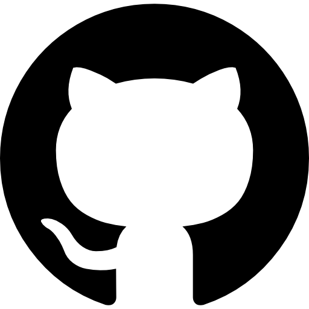

# Actividad-2_3

## ACTIVIDAD 2.3 DE DESPLIEGUE DE APLICACIONES 2º DAW

### MADE BY GABRIEL SSB

En la actividad **2.3 Despliegue de aplicaciones** hemos practicado realizar commits y pushes
desde _VisualStudio Code_, la consola local y _GitHub_ de esta forma comprobando como se generar
cambios entre ambos contenedores y al mismo tiempo como solucionar conflictos que se puedan
producir en el proyecto

Se puede comprobar la actividad que hemos hecho desde este enlace:
[ActividadGitHub](https://github.com/Gaby-cyber102/Actividad-2_3)



El codigo que hemos generado es el siguiente:

```
<!DOCTYPE html>
<html lang="en">

<head>
    <meta charset="UTF-8">
    <meta name="viewport" content="width=device-width, initial-scale=1.0">
    <title>Index</title>
</head>

<body>
    <h1>Modulos de Desarrollo de Aplicaciones Web</h1>
    <ul>
        <li>Despliegue de Aplicaciones Web</li>
        <li>Disenyo de Interfaces Web</li>
        <li>Desarrollo web en Entorno Servidor</li>
        <li>Desarrollo web en Entorno Cliente</li>
        <li>Sostenibilidad</li>
        <li>Digitalización</li>
    </ul>
</body>

</html>
```
